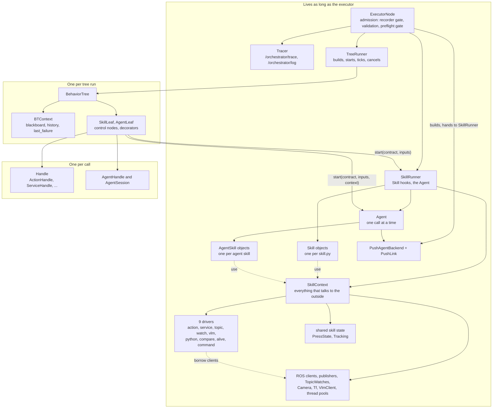
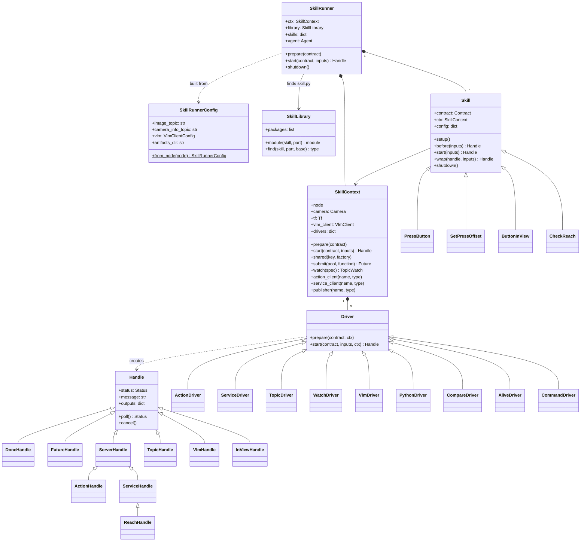
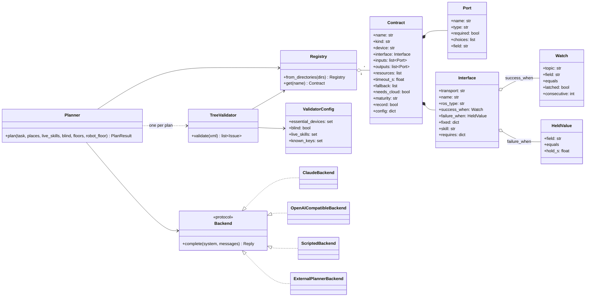
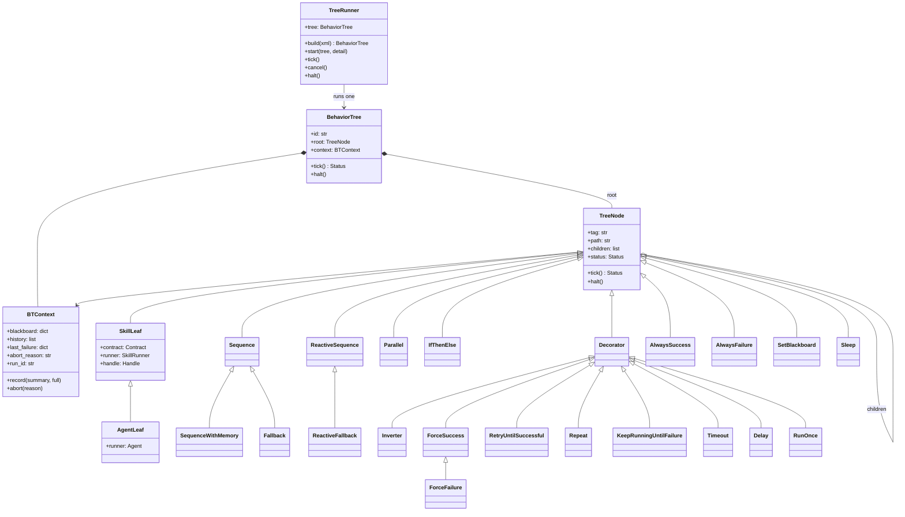
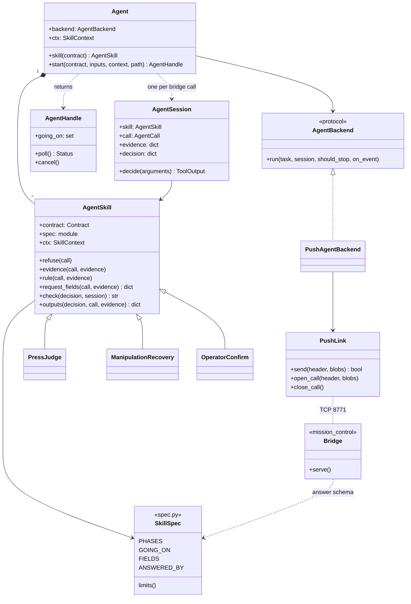

# Classes and interfaces

Who owns what inside the executor, how long each object lives, and the interfaces between the parts. The API reference has every class in full; this page shows how they fit together.

## Who owns what

Most objects live as long as the executor. Each tree run owns its tree, and each skill call owns its handle.

The executor knows no skill state. A rejected or finished tree leaves everything in the top box untouched, so the next tree finds its clients ready.

## Interfaces between the parts

Each boundary is a small base class or protocol. A part depends on the interface, so the tests swap in fakes without ROS.

| Interface | Defined in | Implemented by | Used by |
|---|---|---|---|
| `SkillRunner` protocol: `start(contract, inputs)`, `agent` | `orchestrator/orchestrator/tree/leaf.py` | `skills.runtime.SkillRunner`, test fakes | `SkillLeaf`, `make_leaf_factory` |
| `AgentRunner` protocol: `start(contract, inputs, context, path)` | `orchestrator/orchestrator/tree/leaf.py` | `agent.api.Agent` | `AgentLeaf` |
| `LeafFactory` protocol | `orchestrator/orchestrator/tree/engine.py` | `make_leaf_factory()` | `BehaviorTree`, `TreeRunner` |
| `Trace`, `Logger` protocols | `orchestrator/orchestrator/tree/runner.py` | `Tracer`, the node's logger | `TreeRunner` |
| `Handle`: `poll()`, `cancel()`, `outputs`, `message` | `orchestrator/orchestrator/skills/api.py` | the drivers' handles, `InViewHandle`, `ReachHandle` | `SkillLeaf` polls it each tick |
| `Skill`: `setup`, `before`, `start`, `wrap`, `shutdown` | `orchestrator/orchestrator/skills/api.py` | each `skill.py` in `g1_skills` | `SkillRunner` |
| `Driver`: `prepare`, `start` | `orchestrator/orchestrator/skills/transports.py` | the nine built-in drivers | `SkillContext` only |
| `AgentSkill`: `evidence`, `rule`, `check`, `outputs`, ... | `orchestrator/orchestrator/agent/api.py` | each `agent.py` in `g1_skills` | `Agent`, `AgentSession` |
| `AgentBackend` protocol: `run(task, session, ...)` | `orchestrator/orchestrator/agent/api.py` | `PushAgentBackend` | `Agent` |
| `Backend` protocol: `complete(system, messages)` | `orchestrator/orchestrator/planning/backends.py` | Claude, OpenAI-compatible, scripted, external | `Planner` |
| `Contract` | `skill_registry/skill_registry/contract.py` | every `contract.yaml` | registry, validator, planner, context, leaves |

## Skill runtime

`SkillRunner` runs a skill's own hooks around the context's call. `SkillContext` owns the drivers and every client they borrow.

`PressButton`, `SetPressOffset`, `ButtonInView`, `CheckReach` and their handles live in `g1_skills`. `ButtonInView` and `CheckReach` use the `python` transport, so they start every call themselves.

## Contracts, validation and planning

A `Contract` is the one description of a skill. The registry, the validator, the planner prompt and the context all read it.

The planner, the executor, `send_tree` and `validate_tree` share one validator. Only the planner checks that a skill is live.

## Tree engine and runner

`orchestrator.tree` interprets BehaviorTree.CPP v4 XML in Python. `TreeRunner` runs one tree at a time and leaves the choice of tree to its caller.

`SkillLeaf` enforces the contract's `timeout_s` and cancels the handle when it runs out. An `AgentLeaf`'s runner is the `Agent`. An `abort` decision calls `BTContext.abort()`, which fails the whole tree. `Timeout`, `Delay` and `Sleep` also share the `Timed` mixin, which keeps their start time.

## Agent engine and bridge

The executor checks every decision the bridge returns, from the model or the operator. Each `AgentSkill` supplies evidence, rules and checks, and `spec.py` fixes the allowed answers.

What each decision does to the leaf and the tree, and what the model sees, is in `docs/agents.md`.
