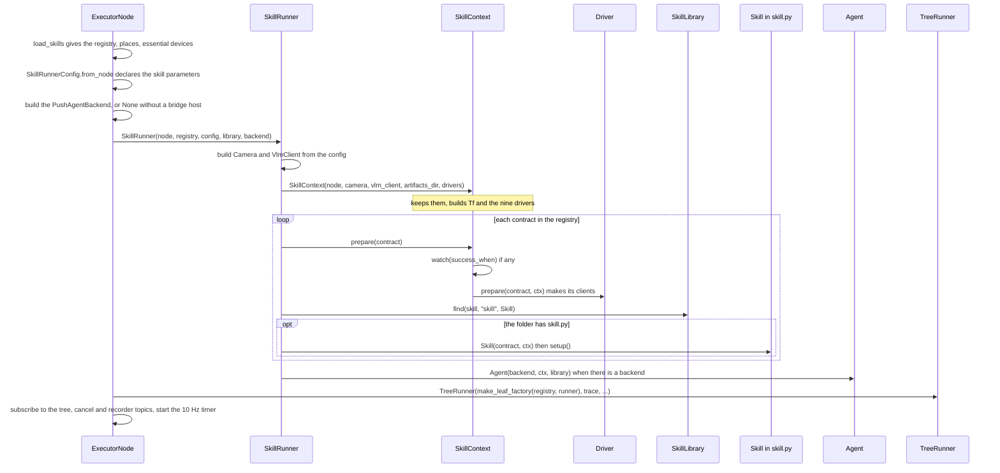
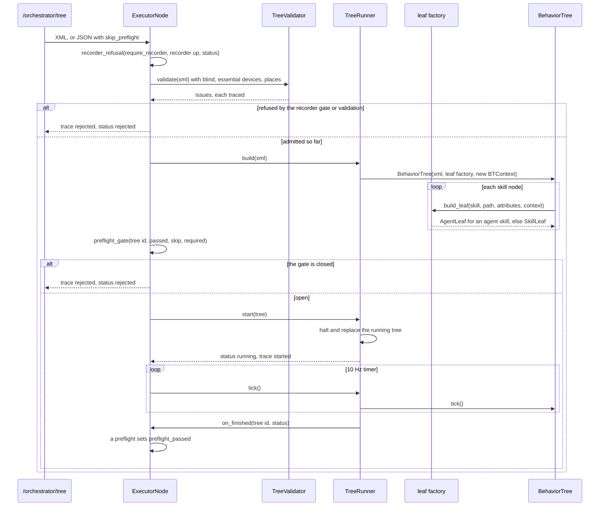
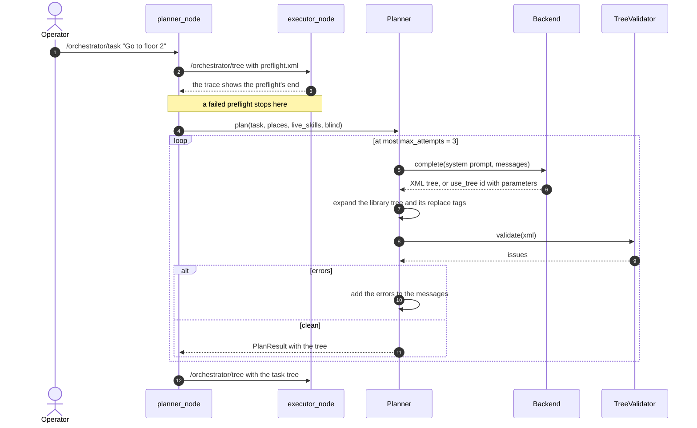
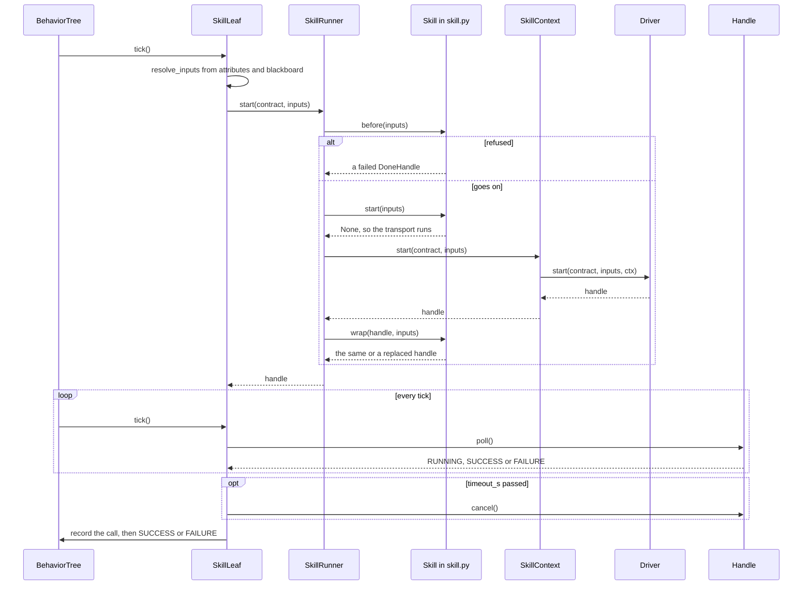
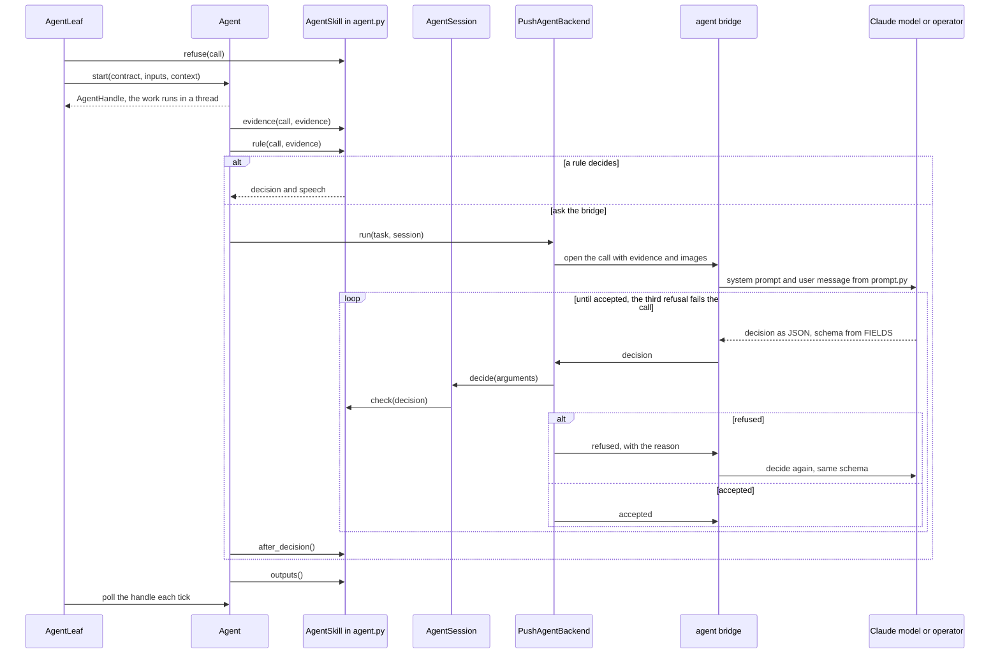

# Sequences

How the executor starts, how a tree is admitted and run, how a task is planned, and how one skill call and one agent call unfold. Read [Classes and interfaces](classes.md) first for the objects these diagrams name.

## Executor startup

Everything skills share is built once, before any tree arrives. Each contract's clients are made early, so a tree's first call finds them ready.

A contract whose `prepare` fails is only logged. It fails later, when a tree calls it.

## A tree arrives

The executor decides whether a tree may run; `TreeRunner` runs it. A refused tree leaves the running one alone.

Starting a preflight closes the gate until it succeeds. `send_tree --skip-preflight` runs a task tree anyway and traces `preflight_skipped`.

## Planning a task

The planner gates on preflight, then loops the LLM and the validator until the tree is clean or three attempts are spent.

The system prompt carries every contract, the places, the live skills and the tree library.

## One skill call

A leaf starts its call once, then polls the handle every tick. The skill's own code runs around the context's call.

A skill without `skill.py` goes straight to the context. Action handles keep their feedback, so a failure carries its whole trajectory as evidence.

## One agent call

Rules answer first when the evidence is plain. Otherwise the bridge asks a model, and the executor refuses bad decisions until one passes.

A decision in `GOING_ON` gives SUCCESS, and `abort` fails the whole tree. With no word from the bridge for 60 s the call fails, and later calls fail at once until it returns.
