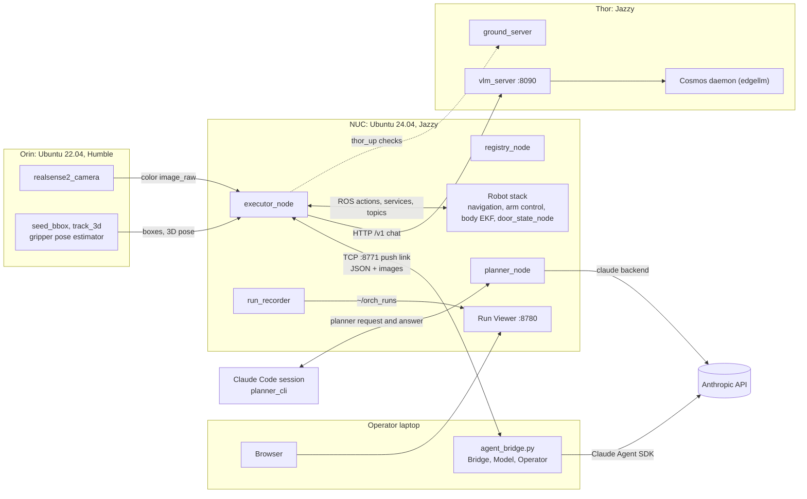
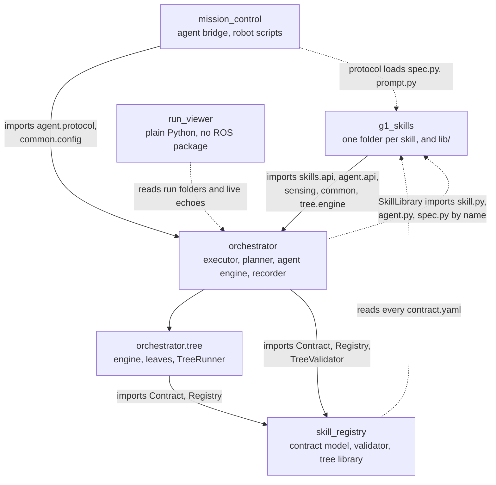
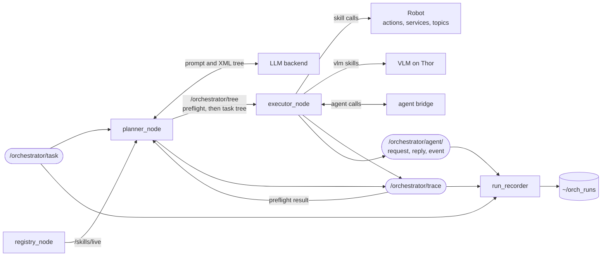
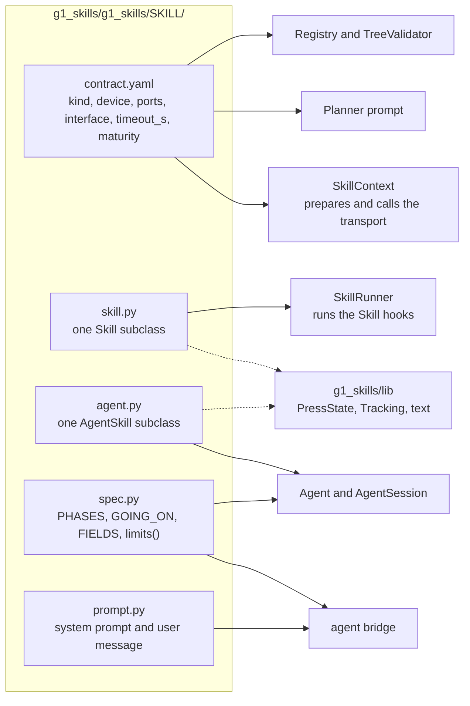

# System

The machines, the packages and how a task becomes robot motion. Start here for the big picture, then read [Classes and interfaces](classes.md) for the code inside the executor.

## Deployment

The NUC runs the whole orchestrator. The Orin sees, the Thor answers VLM questions, and the operator laptop answers agent calls.

The executor reads the raw camera stream from the Orin. Without a site file, no bridge address is set and agent skills fail.

## Packages

The core names no skill. It imports contracts from `skill_registry` and finds skill code in `g1_skills` by name at runtime.

Solid arrows are imports; dashed arrows are files found at runtime. `tree/leaf.py` still imports the agent and skill APIs for `AgentLeaf`, the last tie before `tree/` can stand alone.

## From a task to robot motion

A sentence becomes a validated tree, and every step lands on the trace. The recorder keeps all of it.

The planner learns the preflight result from the trace. The topic names live in `orchestrator/orchestrator/common/topics.py`.

## A skill folder

Each file in a skill folder has one reader in the core. A contract alone is a working skill.

Only `python` skills must have `skill.py`. The executor and the bridge both read `spec.py`, so both enforce the same decisions.
