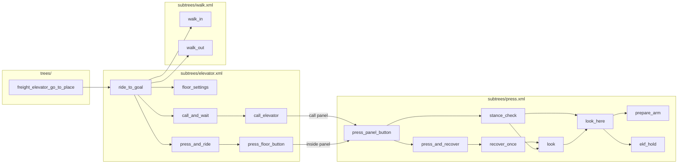
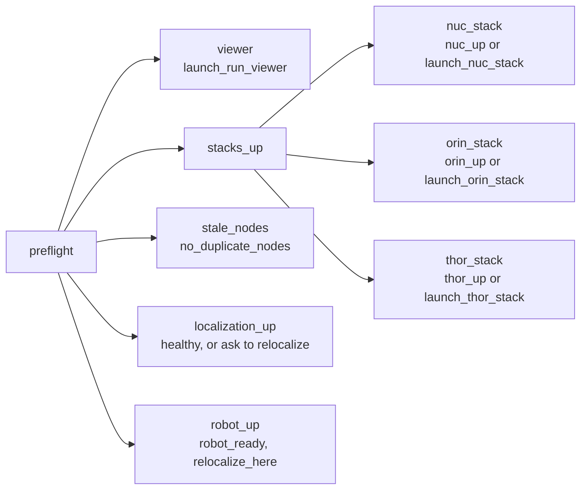
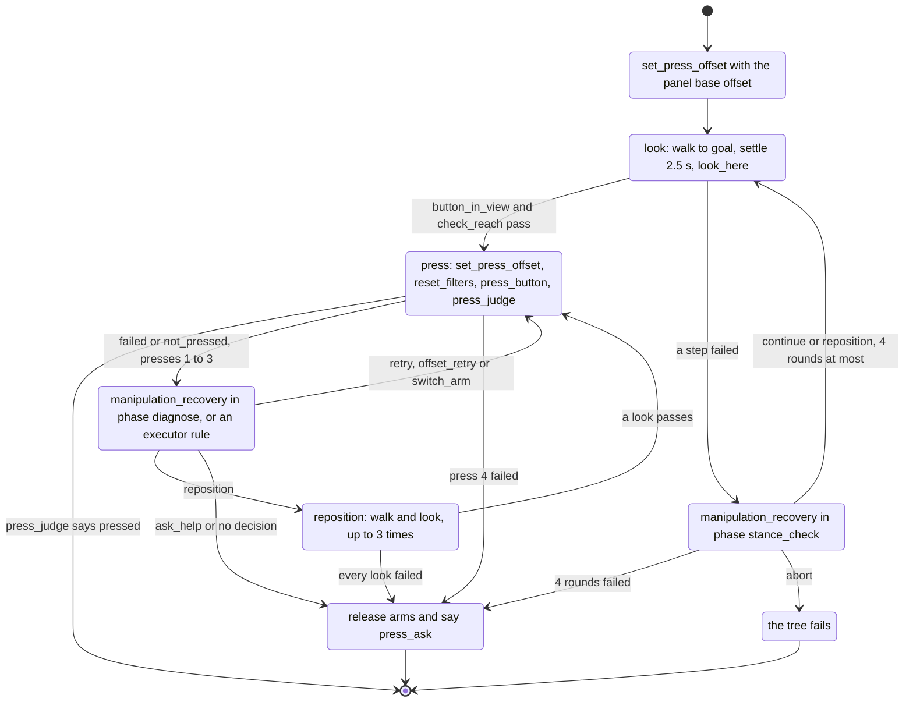

# Trees and the press slot

The library trees the planner reuses, the preflight tree, and the state machine every button press follows. The XML lives in `skill_registry/trees/` and `skill_registry/preflight/`.

## Library tree: subtree calls

One library tree rides the freight elevator. It is built from small subtrees, and `press_panel_button` serves both panels.

The planner may pick this tree with `use_tree`, set its parameters, or swap a subtree. The walk subtrees are described in [Architecture](../architecture.md#walking-into-and-out-of-the-cabin).

## Preflight tree

Preflight brings every machine up and proves the robot is ready. The executor runs no task tree until it passes.

A preflight that does not succeed closes the gate again. The gate itself is in [Sequences](sequences.md#a-tree-arrives).

## The press slot

Every button press runs this slot. It checks the stance first, then presses up to four times with a diagnosis between failures.

`continue` reruns `look_here` where the robot stands, and `reposition` walks to the new goal first. The full rules are in [Agent skills](../agents.md#the-press-slot).
